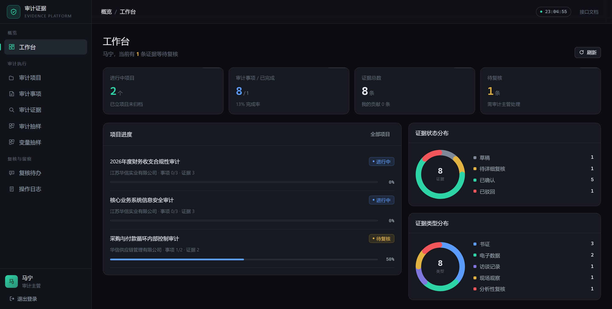
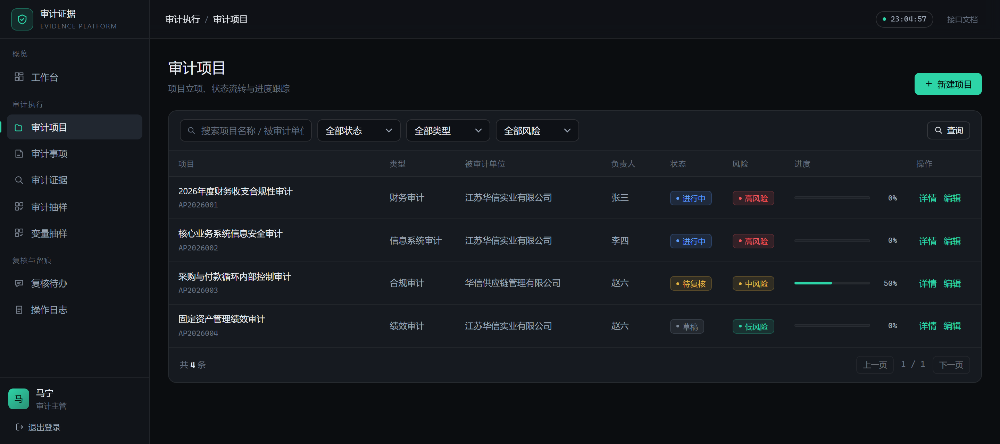
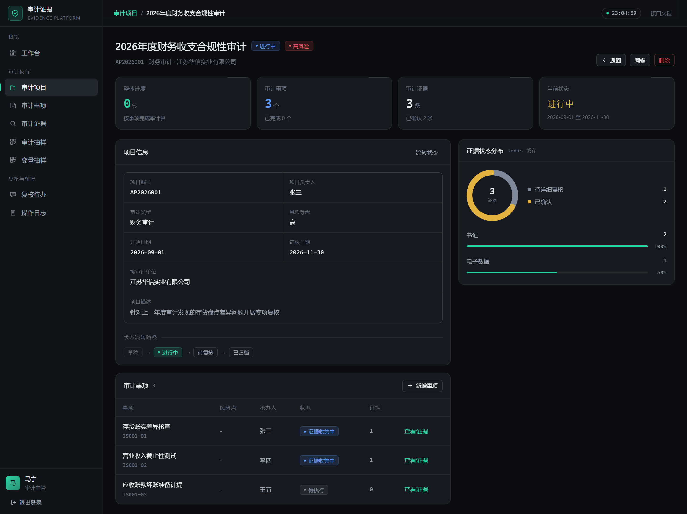
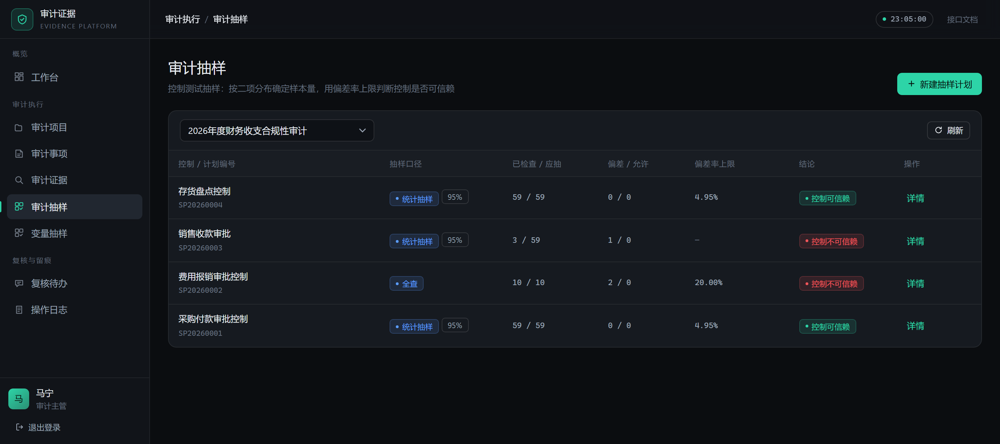
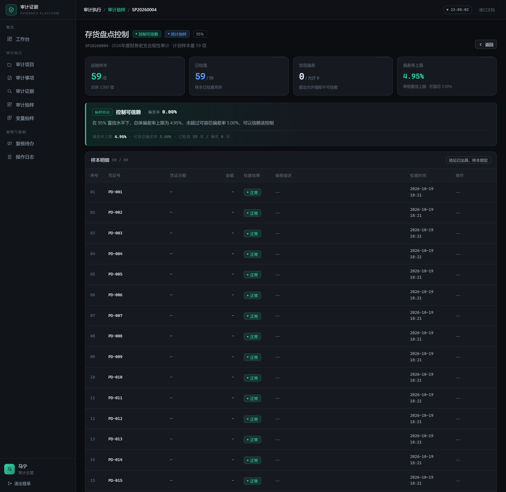
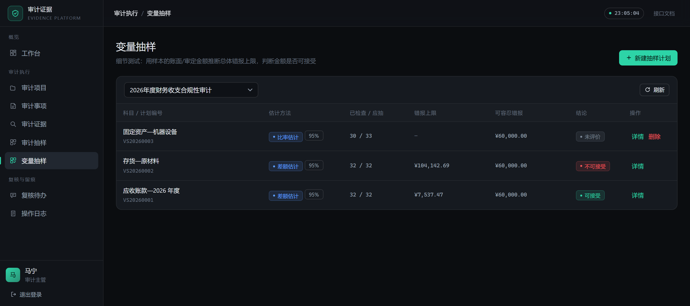
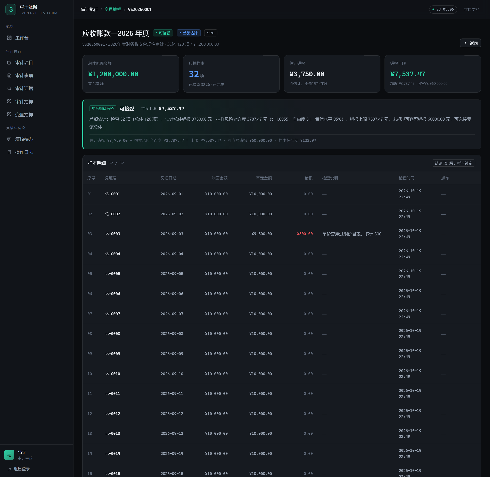
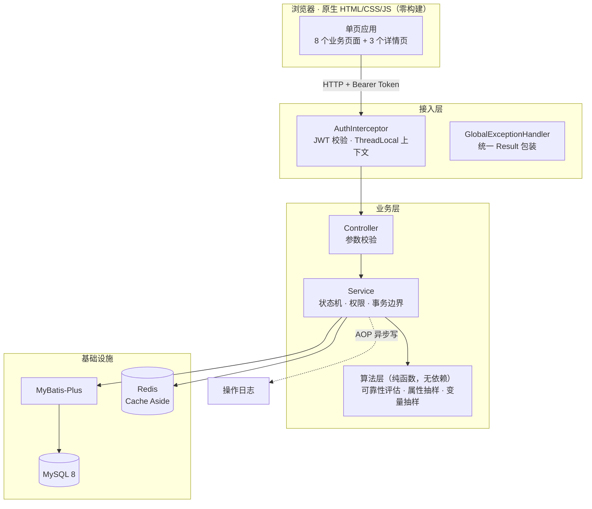
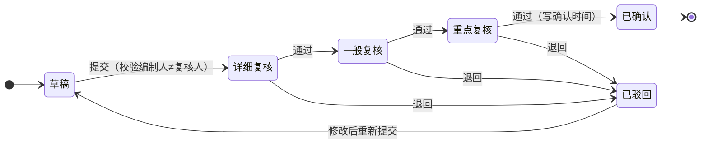

<div align="center">

# 审计证据管理系统

**面向会计师事务所三级复核场景的审计信息化系统**

把《中国内部审计准则》的条文，变成能跑的状态机、能算的算法、能追溯的数据

[](https://github.com/morning-zy/audit-evidence-system/actions/workflows/ci.yml)
[](https://openjdk.org/projects/jdk/21/)
[](https://spring.io/projects/spring-boot)
[](https://www.mysql.com/)
[](https://redis.io/)
[](LICENSE)

**267** 个单元测试 · **64.2%** 行覆盖 · **48** 个 REST 接口 · **8** 个业务页面

[Docker 一键启动](#快速开始) · [系统设计](#系统架构) · [核心实现](#几个值得说的实现) · [踩坑记录](#踩坑记录) · [文档索引](#文档索引)

</div>



---

## 这个项目解决什么问题

审计项目会被拆成若干**审计事项**，每个事项下的证据材料要走 `采集 → 提交 → 详细复核 → 一般复核 → 重点复核 → 已确认` 的流程（依据财政部《会计师事务所质量管理准则第 5101 号》的项目质量复核制度）。现实中这套流程靠 Excel + 邮件 + 微信群推进，问题很具体：

- 谁在什么时候改了哪条记录，查不清
- 提交人给自己复核，没人拦
- 抽样数量拍脑袋，抽多少、能不能下结论说不清

这个系统把三件事做成了代码约束：**流程不可跳级**、**编制与复核强制分离**、**抽样结论有统计依据**。

### 三个业务价值

| | 做法 |
|---|---|
| **编制与复核分离** | 服务层强制校验复核人 ≠ 提交人，不靠界面隐藏按钮 |
| **全链路留痕** | 每次状态变更写 `evidence_flow`，存操作人姓名**快照**（改名后历史仍显示当时姓名） |
| **结论可解释** | 抽样不是"抽了没问题"，而是给出置信上限并与可容忍偏差率比较 |

---

## 功能一览

| 模块 | 能做什么 | 关键实现 |
|---|---|---|
| **认证与权限** | JWT 登录，三角色（主管 / 审计员 / 查阅人） | 拦截器 + ThreadLocal 上下文，登录失败不暴露用户名是否存在 |
| **项目管理** | 立项、状态流转、进度统计 | 派生表 LEFT JOIN 把 N+1 查询压成 2 次 |
| **审计事项** | 按风险等级管理审计点 | 与项目级联，删除保护 |
| **审计证据** | 采集、提交、三级复核、退回 | 状态机 + `SELECT ... FOR UPDATE` 悲观锁防并发重复复核 |
| **可靠性评估** | 按准则 1301 号五原则给证据评级 | 五维加权 → A/B/C/D，评级依据随底稿留痕 |
| **属性抽样** | 控制测试：算样本量、推断偏差率上限 | 二项分布精确解 + Clopper-Pearson 区间 |
| **变量抽样** | 细节测试：三种估计法推断错报上限 | t 分布精度 + 有限总体校正 |
| **操作日志** | 全量操作留痕，仅主管可见 | AOP + 自定义注解，业务代码零侵入 |

### 界面

| 审计项目 | 项目详情（事项与进度） |
|---|---|
|  |  |

| 属性抽样：列表 | 属性抽样：结论与样本明细 |
|---|---|
|  |  |

| 变量抽样：列表 | 变量抽样：估计与精度 |
|---|---|
|  |  |

> 属性抽样详情页里 `4.95% < 5.00%` 是真实算出来的：59 项零偏差、95% 置信水平，
> 上限刚好压线通过。变量抽样详情页展示的是「点估计 + 抽样风险允许度 = 错报上限」的完整推导链。

---

## 技术栈

| 层次 | 选型 | 说明 |
|---|---|---|
| 语言 / 运行时 | Java 21 | record、switch 模式匹配、虚拟线程压测脚本 |
| 框架 | Spring Boot 3.5.16 | Web / Validation / AOP |
| 持久层 | MyBatis-Plus 3.5.17 | 逻辑删除、雪花 ID、条件构造器；复杂查询手写 SQL |
| 数据库 | MySQL 8.0 | 11 张表（业务 7 张 + 抽样 4 张） |
| 缓存 | Redis 7 | Cache Aside，空值缓存防穿透 |
| 认证 | JJWT 0.12 | HS256 |
| 前端 | 原生 HTML / CSS / JS | 零构建、零依赖，无框架 |
| 构建 | Maven + JaCoCo | 覆盖率门槛卡在构建里 |
| 交付 | Docker 多阶段构建 + Compose | 运行时镜像 425MB（仅 JRE + jar） |

---

## 快速开始

### 方式一：Docker（推荐，一条命令）

```bash
git clone https://github.com/morning-zy/audit-evidence-system.git
cd audit-evidence-system
docker compose up -d
```

首次会构建镜像，约 3–5 分钟。等 `docker compose ps` 里三个容器都是 `healthy`（约 40 秒）后访问：

前端入口：[http://localhost:8090/api/ui](http://localhost:8090/api/ui) ，账号 `admin` / `123456`

```bash
docker compose logs -f app    # 跟踪日志
docker compose down           # 停止，保留数据
docker compose down -v        # 停止并重置数据库
```

> 想改密码或 JWT 密钥：`cp .env.example .env` 后修改，compose 会自动读取。不建 `.env` 也能跑（用的是演示默认值）。

### 方式二：本地 IDE 调试

```bash
# 1. 只起中间件（MySQL 映射到 3307，Redis 映射到 6380，避免和本机已装的服务抢端口）
docker compose up -d mysql redis

# 2. 启动应用（默认 dev profile，已按上面的端口配好）
mvn spring-boot:run
```

Windows + Git Bash 下如果 `mvn` 交互异常，用仓库里的包装脚本 `./mvn-bash.sh`，参数与 `mvn` 完全一致。

### 接口文档

启动后访问 [http://localhost:8090/api/swagger-ui.html](http://localhost:8090/api/swagger-ui.html) ，48 个接口，支持点右上角 Authorize 填 token 调试。

---

## 系统架构



**依赖方向单向**：`Controller → Service → Mapper`，算法层不依赖 Spring，可单独单元测试。这让三个算法类（抽样、可靠性）能做到 90%+ 的行覆盖，因为它们是纯粹的输入输出。

### 证据状态机



状态迁移白名单写在 Service 里，任何"跳级"或"回退到非法状态"的请求直接抛业务异常，前端改 DOM 也绕不过去。

---

## 几个值得说的实现

### 1. 三级复核：状态机 + 悲观锁

并发场景很真实：两个主管同时点"通过"，如果不加锁，状态会被推进两次，第三级复核直接消失。做法是在查询时就加行锁：

```java
// EvidenceMapper
@Select("SELECT * FROM audit_evidence WHERE id = #{id} AND deleted = 0 FOR UPDATE")
AuditEvidence selectByIdForUpdate(@Param("id") Long id);
```

`FOR UPDATE` 必须在事务内才生效，所以整个复核方法包在 `@Transactional` 里；第二个请求会阻塞到第一个提交，然后读到最新状态，再走一遍状态校验就会被拒。

### 2. 属性抽样：把准则 1314 号算成结论

控制测试问的是"这个控制有没有被有效执行"，输出是**总体偏差率上限**。

样本量用二项分布反解 —— 找到最小的 `n`，使得在可容忍偏差率 `TDR` 下，出现不超过允许偏差数的概率小于风险水平：

```
P(X ≤ k | n, TDR) ≤ 风险水平   →  求最小 n
```

推断阶段用 Clopper-Pearson 精确区间（不是正态近似）：

```
上限 = BetaInv(1 - α; k+1, n-k)
```

**校验**：算出来的样本量与准则附录的抽样表逐项吻合（TDR 5% / 风险 5% / 预期偏差 0 时 n = 59；偏差 1 时 n = 93），说明公式落地没错。

三种口径分开处理，这是业务上容易糊弄的地方：

| 口径 | 结论依据 | 为什么 |
|---|---|---|
| 统计抽样 | 给出 95% 置信上限 | 有统计基础，可以推断总体 |
| 判断抽样 | 不给置信上限 | 样本非随机，推断不成立 |
| 全查 | 给实际偏差率，不给上限 | 总体已全查，无需抽样风险 |

还实现了**停止-前进规则**：已发现的偏差超过允许值，立即终止，不必抽满 —— 继续抽只是浪费工时，结论不会翻转。

### 3. 变量抽样：三种估计法，误用会「安静地算错」

金额测试问的是"账上金额对不对"，输出是**总体错报上限**。

| 方法 | 点估计 | 适用前提 |
|---|---|---|
| 均值估计 | `N × 样本平均错报` | 错报与金额无关 |
| 差额估计 | `N × 样本平均差额` | 样本量接近总体，且错报均匀 |
| 比率估计 | `总体账面 × (样本错报/样本账面)` | 错报金额与账面金额成比例 |

精度用 **t 分布**而非正态近似。n=30、95% 时 `t=1.6991` 而 `z=1.6449`，差 3.2%，在几十万的总体金额上就是上万块的精度差 —— 这不是学术洁癖，是会影响结论的。

代码里有一个容易漏掉的边界：**样本零错报时标准差为 0，t 区间会塌缩成 0**，等于宣称"总体没有错报"。改用泊松基本精度兜底：

```
基本精度 = -ln(风险水平) × 总体账面 / 样本量
```

实测 50 项全干净、总体 100 万时，上限算出 59,913 而不是 0 —— "抽了没发现问题"不等于"没问题"。

### 4. 缓存：从 10.28ms 到 2.96ms，以及三个必须防的坑

项目统计接口每次都要聚合多个表，冷启动实测 **10.28ms**，走 Redis 后 **2.96ms**（约 3.4 倍）。但缓存真正的难点不是提速，是失效：

| 问题 | 触发条件 | 处理 |
|---|---|---|
| **穿透** | 查询不存在的 ID，每次都打到库 | 空值也缓存，TTL 缩短到 60 秒 |
| **击穿** | 热点 key 过期瞬间并发涌入 | 逻辑过期 + 互斥重建（分布式锁） |
| **雪崩** | 大批 key 同时过期 | TTL 加随机抖动，过期时间打散 |

写操作**主动删除**缓存而不是更新 —— 更新缓存在并发下会写入旧值，删除是幂等的，下次读自然回填。

### 5. 前端：不引入框架是一次刻意的取舍

8 个页面、3 个详情页、流转时间轴、动态菜单，全部手写原生 JS，约 3000 行，零构建、零依赖。

理由不是"炫技"，而是：这个项目的重点是后端业务规则与算法，引入 Vue + Element Plus 会带来 2 个配置文件、1 个构建链、几百 MB `node_modules`，而收益只是省下几百行 DOM 操作。**克隆下来 `docker compose up` 就能跑，不需要 `npm install`** —— 对别人验证你的项目来说，这个体验差别很大。

代价也明确写在 [已知限制](#已知限制) 里。

---

## 工程质量

### 测试

```bash
mvn test         # 267 个单元测试，约 6 秒
mvn verify       # 额外跑覆盖率门槛检查，不达标构建失败
```

| 测试类 | 用例数 | 覆盖对象 |
|---|---|---|
| `SamplingCalculatorTest` | 38 | 准则 1314 号抽样算法（100% 行） |
| `EvidenceReviewWorkflowTest` | 37 | 三级复核状态机（100% 行） |
| `EvidenceServiceImplTest` | 35 | 证据业务与权限 |
| `VariableSamplingCalculatorTest` | 32 | 三种估计 + t 分布（与 t 表逐项对照） |
| `EvidenceReliabilityEvaluatorTest` | 25 | 准则 1301 号可靠性算法（100% 行） |
| `EnumsConsistencyTest` | 22 | 枚举契约（码唯一、映射互逆） |
| `ProjectServiceImplTest` | 18 | 项目状态流转 |
| `AuthServiceImplTest` / `VariableSamplingServiceImplTest` | 14 / 14 | 认证 / 试点扩样 |
| `SamplingServiceImplTest` | 14 | 三种抽样路径的结论口径 |
| `StatServiceCacheTest` | 11 | 缓存穿透 / 击穿 / 雪崩 |
| `JwtUtilTest` | 7 | 签发、解析、防篡改 |
| **合计** | **267** | |

**JaCoCo 门槛**：行 ≥ 50%、分支 ≥ 45%，当前 **64.2% / 58.6%**。实体、DTO、Mapper 接口、启动类已从统计中排除 —— 把 getter/setter 算进覆盖率是自欺欺人。

测试全部是 Mockito 纯单元测试，**不依赖数据库和 Redis**，所以 CI 里 6 秒跑完，不需要起中间件。

### CI

`.github/workflows/ci.yml`：JDK 21 → `mvn verify` → 覆盖率报告作为 artifact → 主分支额外验证 Docker 镜像可构建，并检查镜像以非 root 用户运行、体积不超过 300MB。

### 容器化

多阶段构建把编译产物从 Maven 镜像搬到 JRE 镜像，最终 **425MB**（alpine JRE 287MB + fat jar 70MB，实测）。几个细节是刻意的：

- `COPY pom.xml` 单独一层，依赖缓存命中后构建从 3 分钟降到 20 秒
- `COPY --chown` 而不是 COPY 之后再 `chown -R`：后者会让 Docker 的写时复制把 70MB 的 jar 整层复制一遍，镜像凭空多 70MB
- alpine 基础镜像不带时区数据库，`TZ` 环境变量要配合 `apk add tzdata` 才真正生效
- `ENTRYPOINT` 用 exec 形式（JSON 数组），保证 java 进程是 PID 1，能收到 `SIGTERM` 走优雅停机
- `adduser -S app` 后 `USER app`，不用 root 跑应用
- `healthcheck` + `depends_on: condition: service_healthy`，等 MySQL 真正可连接再启动应用

---

## 项目结构

```
audit-evidence-system/
├── src/main/java/com/maning/audit/
│   ├── annotation/        # @OpLog 自定义注解
│   ├── aspect/            # 操作日志切面
│   ├── common/
│   │   ├── constant/      # 枚举（状态、角色、抽样口径）
│   │   ├── result/        # Result / ResultCode 统一响应
│   │   └── util/          # 抽样算法、JWT、雪花 ID
│   ├── config/            # Jackson、Redis、MyBatis-Plus、Web
│   ├── controller/        # 8 个控制器，48 个接口
│   ├── dto/ vo/           # 入参与出参
│   ├── entity/            # 10 个实体 + 公共基类
│   ├── exception/         # 业务异常 + 全局处理
│   ├── interceptor/       # JWT 鉴权
│   ├── mapper/            # MyBatis-Plus Mapper
│   └── service/           # 接口与实现
├── src/main/resources/
│   ├── db/                # schema.sql + data.sql（演示数据）
│   ├── static/ui/         # 原生前端（index.html + css + 4 个 js）
│   ├── application.yml    # 公共配置
│   ├── application-dev.yml    # 本地：127.0.0.1:3307 / 6380
│   └── application-docker.yml # 容器：compose 服务名寻址
├── src/test/java/         # 12 个测试类，267 个用例
├── docs/screenshots/      # 界面截图
├── tools/                 # 压测 / 冒烟 / 一致性校验脚本（不参与构建）
├── Dockerfile
├── docker-compose.yml
└── .github/workflows/ci.yml
```

---

## 踩坑记录

这些不是"配置一下就好了"的问题，是上线前真跑才暴露的。每条都对应代码里的一个修改。

| 现象 | 根因 | 修复 |
|---|---|---|
| 详情页 404，但接口用 curl 能调通 | 19 位雪花 ID 被 JS `Number()` 截断，末位精度丢失 | Jackson 全局把 `Long` 序列化为字符串，前端全链路按字符串传递 |
| 撤销检查后状态没变化 | MyBatis-Plus 默认忽略 `null` 字段，`deviation=null` 没进 SQL | 该字段加 `@TableField(updateStrategy = ALWAYS)` |
| 撤销时数据库报 `Column 'deviation' cannot be null` | 建表 `NOT NULL DEFAULT 0`，与"null=未检查"的三态语义冲突 | 改为可空，`0/1/NULL` 分别表示无偏差/有偏差/未检查 |
| 删除抽样计划后新建，唯一索引冲突 | 编号生成排除了已删记录，但唯一索引仍占着这些编号 | 编号不复用：查询最大值时包含逻辑删除记录，并按数值而非字符串排序 |
| 容器里中文全是问号 | MySQL 官方镜像客户端默认 `latin1`，UTF-8 被双重编码 | 初始化 SQL 首行 `SET NAMES utf8mb4`，并重建数据卷 |
| 全查场景的上限字段是 null | 判断顺序错误：先撞"偏差超标"分支，跳过了"已抽满"分支 | 先判抽满再判超标 |
| "4.95% 未超过 5.00%" 显示成 "5.0% 未超过 5.0%" | `%.1f` 格式化把差异抹掉了 | 统一 `%.2f` |
| `docker kill` 后容器没重启 | `kill` 被视为人为停止，`restart: unless-stopped` 不触发 | 用 `crash-test` 容器（立即 `exit 1`）验证重启策略，`RestartCount` 递增符合退避预期 |

---

## 已知限制

诚实说明比藏着不说更有价值，这些也是下一步要做的：

- **权限是三角色粗粒度**，没有 RBAC 表。真实系统需要"角色-权限-资源"多对多 + 方法级注解鉴权
- **文件只存本地磁盘**，生产应换 MinIO / OSS，并加病毒扫描与大小限制
- **没有分页游标**，大数据量下 `LIMIT offset` 会退化
- **前端无构建链**，没有组件复用和类型检查；页面再多就应该上 Vue + Vite
- **审计日志是同步写库**，高并发下会拖慢主流程，应改异步队列
- **没有真实的多租户隔离**，事务所场景需要按项目组隔离数据

### Roadmap

- [ ] MUS（货币单位抽样）：按金额概率抽样的审计专用方法
- [ ] 分层抽样：按金额区间分层，降低大额项目的样本量
- [ ] 电子表格导入：把客户明细账直接作为总体
- [ ] RBAC 权限模型
- [ ] Testcontainers 集成测试（替代手工起中间件）
- [ ] 操作日志异步化 + 审计日志防篡改（哈希链）

---

## 关于数据

仓库里的 `data.sql` 是**虚构的演示数据**（虚拟公司、虚拟凭证号），不含任何真实客户信息。生产使用时删除 `data.sql` 并接入真实组织架构。

## License

[MIT](LICENSE) © 2026 Ma Ning
